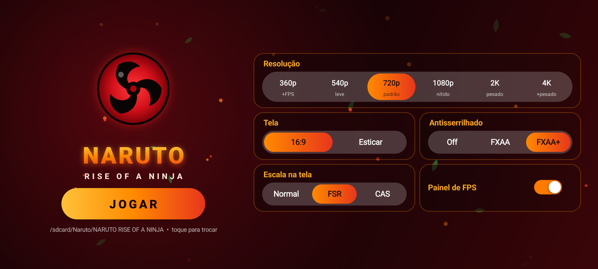
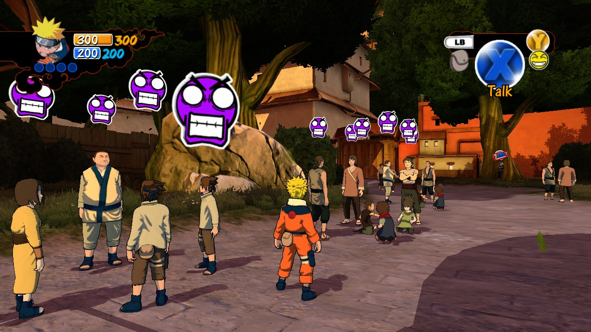
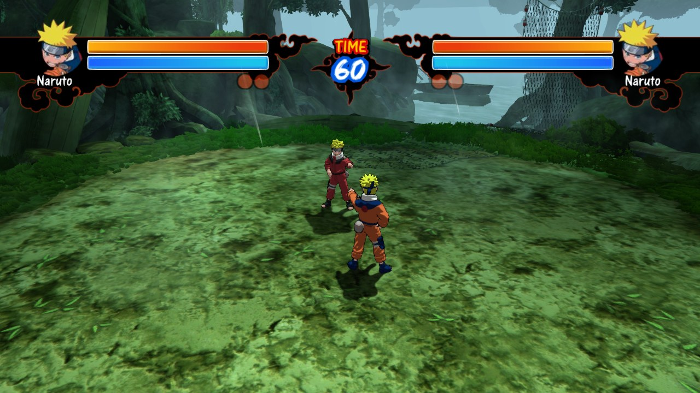
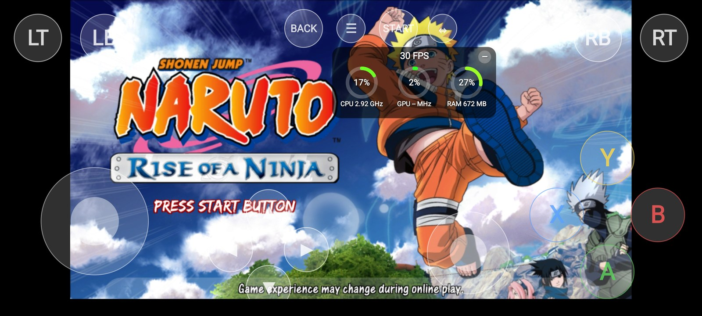
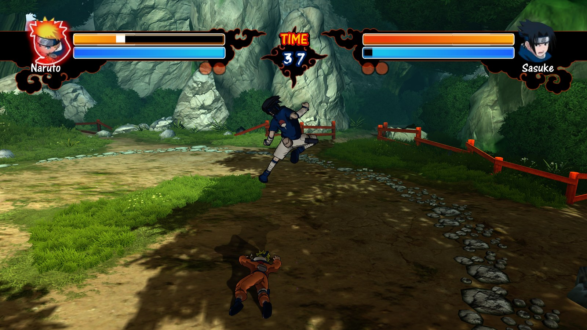
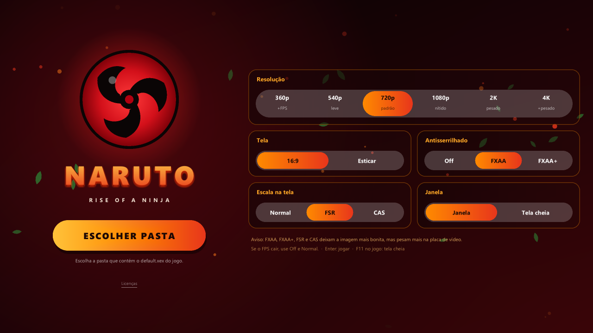

<div align="center">

# 🍥 Naruto: Rise of a Ninja — Port Nativo

**O jogo de Xbox 360 rodando nativamente no Android (ARM64) e no PC (Windows x64), sem emulador de CPU.**


[**⬇️ Baixar (Android e PC)**](../../releases/latest) · [Requisitos](#-requisitos) · [Instalação](#-instalação) · [Configurações](#%EF%B8%8F-configurações) · [Perguntas](#-perguntas-frequentes)



</div>

---

## 📖 Sobre

Este port **não é um emulador de Xbox 360**. O executável do jogo (`default.xex`) e a biblioteca `AI2C.dll` foram **recompilados estaticamente** de PowerPC para ARM64 (celular) e x86-64 (PC). O resultado é código nativo que roda direto no processador. A parte gráfica usa um backend Vulkan adaptado e otimizado para GPUs de celular (Mali e Adreno).

> [!IMPORTANT]
> **O APK e o pacote de PC não contêm nenhum arquivo do jogo.** Você precisa da sua **própria cópia** de *Naruto: Rise of a Ninja* para Xbox 360, na versão indicada em [Versão do jogo](#-versão-do-jogo-obrigatória).

### ✨ Destaques

- **Lutas a 60 FPS e modo história a 30 FPS** (o limite do próprio jogo) no Poco X7 Pro.
- **6 resoluções:** 360p, 540p, 720p, 1080p, 2K e 4K. Menus, vídeos e cutscenes ficam inteiros em todas.
- **Antisserrilhado FXAA e FXAA+** e **escala FSR 1.0 / CAS** da AMD, que podem ser ligados e desligados.
- **Controles na tela:** dois analógicos, D-pad, todos os botões e gatilhos. Controles Bluetooth e USB também funcionam.
- **Painel de desempenho:** FPS e uso de CPU, GPU e RAM. Pode ser arrastado pela tela ou recolhido.
- **Modo 16:9 ou esticado** para a tela inteira.
- Menu inicial com tema de Naruto 🌀, o mesmo no celular e no PC
- **Versão de PC** com janela ou tela cheia, teclado e controles de Xbox ou PlayStation

## 📸 Capturas

| Modo história | Luta |
|:---:|:---:|
|  |  |
| **No celular (controles e painel)** | **Luta em 4K** |
|  |  |
| **Menu no PC** | |
|  | |

## 📱 Requisitos

### Android

| | Mínimo | Recomendado |
|---|---|---|
| **Android** | 11 (API 30) | 13 ou mais novo |
| **Processador** | ARM64 (arm64-v8a) | Snapdragon 8 Gen 1 / Dimensity 8000 ou superior |
| **GPU** | Vulkan 1.1 | Mali-G710 / Adreno 730 ou superior |
| **RAM** | 4 GB | 8 GB ou mais |
| **Espaço** | ~4,5 GB (arquivos do jogo) | — |

Testado no **Poco X7 Pro** (Dimensity 8400 Ultra, Mali-G720, 12 GB).

### 🖥️ PC

| | Mínimo | Recomendado |
|---|---|---|
| **Sistema** | Windows 10 64 bits | Windows 11 |
| **Processador** | x86-64 com AVX | 4 núcleos ou mais |
| **Placa de vídeo** | Vulkan 1.1 (drivers atualizados) | GTX 1060 / RX 580 ou superior (2K e 4K: RTX 3060 / RX 6700 ou superior) |
| **RAM** | 4 GB | 8 GB ou mais |

## 💿 Versão do jogo (obrigatória)

O port foi feito para **uma versão específica** do executável. Outras versões ou regiões **não funcionam**, porque o código foi recompilado a partir deste arquivo.

| Campo | Valor |
|---|---|
| Jogo | Naruto: Rise of a Ninja (Xbox 360) |
| Title ID | `555307E5` |
| Media ID | `12DF7A0D` |
| Versão do executável | `0.0.0.2` (base `0.0.0.2`) |
| Disco | 1 de 1 |

| Arquivo | Tamanho | SHA-1 | MD5 |
|---|---|---|---|
| `default.xex` | 7.516.160 bytes | `3174cb24c35a66019f38e5378a4da298ac1ebf31` | `679daa8af777931ae7d8e3a084fb18d8` |
| `AI2C.dll` | 3.842.048 bytes | `c412aaf5873f77394ab1e246189f43df423a9e6b` | `50b56ec5726ca6b00de18ca97ed54d4d` |

<details>
<summary><b>Como conferir o hash</b></summary>

- **Windows (PowerShell):** `Get-FileHash default.xex -Algorithm SHA1`
- **Linux / macOS:** `sha1sum default.xex`
- **Android:** qualquer app de "hash checker" da Play Store.

</details>

### Estrutura da pasta do jogo

Extraia o disco e copie **a pasta inteira** para o celular. Ela precisa ter, no mínimo:

```
NARUTO RISE OF A NINJA/
├── default.xex        ← executável (precisa bater com o hash acima)
├── AI2C.dll           ← IA do jogo (precisa bater com o hash acima)
├── naruto.bf          ← dados do jogo (~600 MB)
├── xeshader.sdb
├── Naruto.SRA
├── Naruto_clip.SRA
├── LinkApp.xex
├── soundxe.big / soundxe.fat
├── soundxe_en.big / soundxe_en.fat
├── soundxe_fr.big / soundxe_fr.fat
├── media/
└── *.bik              ← 86 vídeos (cutscenes)
```

## 🚀 Instalação

### Android

1. Baixe o **APK** na página de [**Releases**](../../releases/latest) e instale. Talvez seja preciso permitir *"instalar apps de fontes desconhecidas"*.
2. Copie a pasta do jogo para o celular, por exemplo `Armazenamento interno/Naruto/NARUTO RISE OF A NINJA`.
3. Abra o app e toque em **ESCOLHER PASTA**.
4. Permita o **acesso a todos os arquivos**: o jogo lê os dados direto da pasta, sem copiar nada.
5. Escolha a pasta que contém o `default.xex`.
6. Ajuste as configurações e toque em **JOGAR** 🍥

### 🖥️ PC (Windows)

1. Baixe o **`.zip` do Windows** na página de [**Releases**](../../releases/latest) e extraia numa pasta.
2. Abra **`NarutoRiseOfANinja.exe`**.
3. Clique em **ESCOLHER PASTA** e escolha a pasta do jogo, a que contém o `default.xex`.
4. Ajuste as configurações e clique em **JOGAR** (ou aperte Enter).

As configurações, os saves e o cache de shaders ficam na pasta onde você extraiu o port (`naruto.ini`, `data/`, `cache/`), não na pasta do jogo.

> [!TIP]
> Na primeira vez que cada cena aparece, o jogo compila shaders e pode engasgar um pouco. Nas próximas vezes eles já ficam salvos.

## ⚙️ Configurações

| Opção | O que faz | Impacto no desempenho |
|---|---|---|
| **Resolução 360p / 540p** | Renderiza com menos pixels | 🟢 Mais FPS: ideal para celulares mais fracos |
| **Resolução 720p** | Resolução original do Xbox 360 | ⚪ Padrão |
| **Resolução 1080p / 2K / 4K** | Renderiza com mais pixels (2x a 3x) | 🔴 Bem mais pesado, para celulares fortes |
| **Tela: 16:9 / Esticar** | Mantém a proporção original ou estica para a tela toda | ⚪ Nenhum |
| **Janela / Tela cheia** (PC) | Como o jogo abre (F11 ou Alt+Enter alterna durante o jogo) | ⚪ Nenhum |
| **Antisserrilhado: FXAA / FXAA+** | Suaviza as bordas serrilhadas | 🟠 Pesa um pouco a mais |
| **Escala na tela: FSR / CAS** | Amplia a imagem com mais nitidez (AMD FidelityFX) | 🟠 Pesa um pouco a mais |
| **Painel de FPS** | Mostra FPS, CPU, GPU e RAM | ⚪ Quase nenhum |

> [!NOTE]
> Se o FPS cair, use **Antisserrilhado: Off** e **Escala: Normal** e baixe a resolução.

## 🎮 Controles

- **Na tela:** analógicos esquerdo e direito, D-pad, A/B/X/Y, LB/RB, LT/RT, BACK e START.
- O botão **⇔** alterna entre 16:9 e tela esticada durante o jogo.
- **Controle físico:** controles Bluetooth e USB compatíveis com Android são reconhecidos automaticamente.

### 🖥️ PC

Controles de Xbox e PlayStation funcionam direto. No teclado:

| Tecla | Botão | Tecla | Botão |
|---|---|---|---|
| **W A S D** | Analógico esquerdo | **Setas** | Analógico direito |
| **I J K L** | Direcional | **Enter** / **Tab** | START / BACK |
| **Espaço** | A | **E** | B |
| **Q** | X | **F** | Y |
| **1** / **3** | LB / RB | **Z** / **C** | LT / RT |
| **Ctrl esq. / dir.** | Apertar os analógicos | **F11** / **Alt+Enter** | Tela cheia |

## ❓ Perguntas frequentes

<details>
<summary><b>O jogo fecha ao abrir / tela preta</b></summary>

- Confira se o `default.xex` e o `AI2C.dll` batem com os hashes acima.
- Confira se a permissão de **acesso a todos os arquivos** foi dada.
- Confira se a pasta escolhida é a que contém o `default.xex`, e não uma pasta acima dela.

</details>

<details>
<summary><b>Funciona com a versão europeia / japonesa / de outro disco?</b></summary>

Não. O código foi recompilado a partir de um executável específico, então só funciona com a versão da tabela acima.

</details>

<details>
<summary><b>Funciona em celulares 32 bits ou x86? E em Linux ou macOS?</b></summary>

Não. Por enquanto só Android arm64-v8a e Windows x64.

</details>

<details>
<summary><b>O código-fonte está disponível?</b></summary>

Não. Este é um projeto de código fechado. Os componentes de código aberto usados estão listados abaixo, com as respectivas licenças.

</details>

## 🙏 Créditos

Este projeto só foi possível graças a estes projetos de código aberto:

- [**XenonRecomp**](https://github.com/hedge-dev/XenonRecomp): recompilador estático de PowerPC (Xbox 360)
- [**Xenia Canary**](https://github.com/xenia-canary/xenia-canary): referência do hardware do Xbox 360 e base do backend Vulkan
- [**SDL 3**](https://github.com/libsdl-org/SDL): janela, entrada e áudio
- [**FFmpeg**](https://ffmpeg.org): decodificação de áudio XMA
- [**AMD FidelityFX FSR / CAS**](https://github.com/GPUOpen-Effects): escala e nitidez

As licenças completas estão em [THIRD_PARTY_NOTICES.md](THIRD_PARTY_NOTICES.md) e também dentro do app, no link **"Licenças"** do menu.

## ⚖️ Aviso legal

Este é um projeto de fãs, **sem fins lucrativos**, sem nenhuma ligação com a Ubisoft, a Bandai Namco, a VIZ Media, Masashi Kishimoto ou a Microsoft. *Naruto* e *Naruto: Rise of a Ninja* são marcas e obras de seus respectivos donos.

O APK **não inclui** arquivos, vídeos, sons ou texturas do jogo: é preciso ter a sua própria cópia original. Não peça nem compartilhe arquivos do jogo nas issues.

---

<div align="center">
Feito com 🧡 e muito chakra.
</div>
